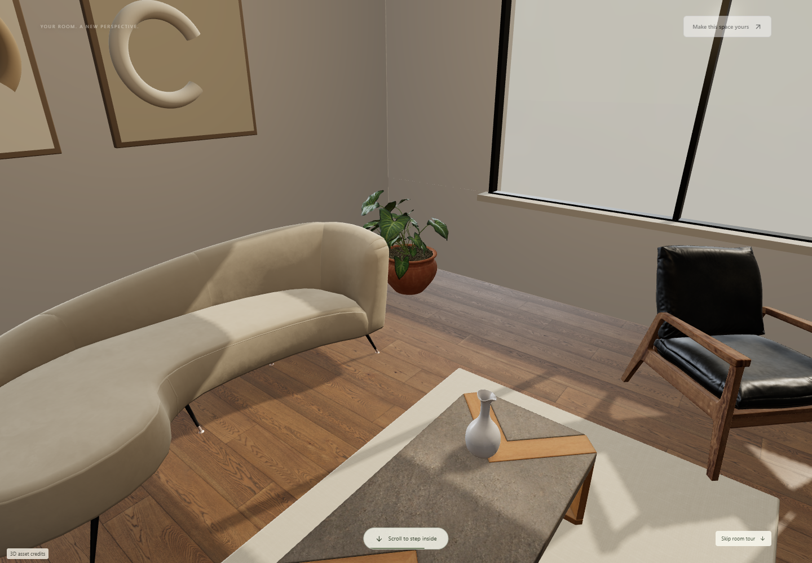

# Showcase graphics — Phase 1

Historical record of the initial landing-only graphics upgrade. Subsequent saved work integrated licensed models into the editor. The current UI-only phase preserves those models and rendering; see PREMIUM_UI_REDESIGN.md.

## Audit and changes

The earlier room used normalized boxes/spheres, solid-color furniture, a generated
floor pattern, and strong ambient/hemisphere lights. It had no image-based lighting,
furniture texture maps or contact shading. These flattened silhouettes and lighting.

The landing room now loads six actual glTF/GLB models. Each model is cloned, uniformly
fitted to a measured footprint, centered horizontally and grounded using its bounds.
Embedded presentation lights are removed. Materials retain authored UVs and PBR maps;
the sofa retains its weave normal map, AO and sheen with a warm cream finish.

Architecture adds a genuine window opening and bronze profiles, reflective glass,
clean warm paint with fine plaster normal/roughness maps, textured oak flooring,
a woven neutral rug, bespoke shelves and restrained relief panels. Shelves, rug and
architecture are procedural meshes; they are not presented as downloaded models.

Lighting uses the local Artist Workshop HDR, a window-side daylight source, a warm
pendant light, modest hemisphere fill, contact shadows, ACES tone mapping and sRGB
output. Base-color textures use sRGB; normal, roughness and AO maps remain linear.
The floor tile represents 1.7 m and rug weave 0.4 m. No bloom or runtime network API.

## Sources and licences

| Asset | Creator | Licence |
| --- | --- | --- |
| [Glam Velvet Sofa](https://github.com/KhronosGroup/glTF-Sample-Assets/tree/main/Models/GlamVelvetSofa) | Eric Chadwick / © 2021 Wayfair, LLC | CC BY 4.0 |
| [Modern Arm Chair 01](https://polyhaven.com/a/modern_arm_chair_01) | Vibrant Nordic | CC0 |
| [Modern Coffee Table 01](https://polyhaven.com/a/modern_coffee_table_01) | Amin | CC0 |
| [Potted Plant 02](https://polyhaven.com/a/potted_plant_02) | Rico Cilliers | CC0 |
| [Modern Ceiling Lamp 01](https://polyhaven.com/a/modern_ceiling_lamp_01) | James Ray Cock | CC0 |
| [Ceramic Vase 01](https://polyhaven.com/a/ceramic_vase_01) | James Ray Cock | CC0 |
| [Wood Floor](https://polyhaven.com/a/wood_floor) | Dimitrios Savva | CC0 |
| [White Plaster 02](https://polyhaven.com/a/white_plaster_02) | Rob Tuytel | CC0 |
| [Fabric Pattern 07](https://polyhaven.com/a/fabric_pattern_07) | Rob Tuytel | CC0 |
| [Artist Workshop](https://polyhaven.com/a/artist_workshop) | Oliksiy Yakovlyev | CC0 |

The visible “3D asset credits” link opens the bundled attribution page. It includes
the sofa's copyright, licence/source links and modifications. All files have verified
download sources, byte counts and SHA-256 hashes in `public/assets/showcase/manifest.json`.
`scripts/fetch-showcase-assets.mjs` resolves official API download URLs and checks
Poly Haven MD5 values. `scripts/verify-showcase-assets.mjs` verifies the offline files
and every glTF dependency. Sources and licence notices ship with the production build.

## Performance and limits

- Bundle: 24.86 MiB of verified asset files; 103,320 furniture triangles before architecture.
- Demand rendering: stationary views stop drawing; scroll progress invalidates frames.
- Shared cached source geometry/textures; instance materials are cloned and disposed.
- Furniture maps are 1K; the hero floor is 2K; HDR illumination is 1K.
- Existing Low/Medium/High preferences control DPR caps (1/1.5/2), shadow maps
  (512/1024/2048), anisotropy (2/4/8), and contact shadows (off/on/on).
- Contact shadows bake once after all assets resolve. No per-frame AO, bloom,
  transmission render pass or postprocessing pipeline is added.
- Real-time raster lighting approximates indirect light; this is not a path-traced
  offline render. Glass uses a cheap reflective transparent material. There is no
  detailed outdoor landscape. Shelving and rug geometry remain custom procedural work.
- The unchanged editor still uses its original procedural catalog. Creating a room
  from the landing CTA opens that editable template, not the showcase's external models.
- Headless software-renderer checks do not establish frame rates on physical devices.

## Changed source files

- `src/features/landing/JourneyScene.tsx`: renderer, HDR, lights, quality, readiness and metrics.
- `ShowcaseFurniture.tsx`: model loading, bounds, materials and resource ownership.
- `ShowcaseArchitecture.tsx`: architecture, PBR surfaces, joinery and contact details.
- `showcaseAssets.ts`: local asset registry, dimensions, placement and quality presets.
- `RoomJourney.tsx`, `journey.css`: loading state and licence credit link.
- `public/assets/showcase/`: local assets, licences, manifest and attribution page.
- Asset acquisition/verification scripts, tests and documentation.

The scroll path in `journeyPath.ts` is preserved. Its unit tests cover 2,001 route
samples; browser tests verify the actual camera, reverse scrolling, responsive layout
and live reduced-motion changes. Asset-loading failure retains an accessible fallback.

## Completed verification

- TypeScript, ESLint, production build: passed.
- Vitest: 24 tests passed.
- Playwright: 8 tests passed across journey, showcase, landing motion and studio suites.
- Verified all bundled hashes/dependencies and absence of runtime asset-provider requests.
- Tested all 2,001 camera samples against the loaded models' actual world-space bounds.
- Browser render remained below 100 draw calls in the measured interior view.
- Reviewed desktop exterior/entry/interior and portrait mobile screenshots.
- Editor checks covered placement/size/colour, 2D/3D, pointer-lock walkthrough, theme,
  save/reload, PNG download and JSON export/import. No editor source was changed.
- Corrected an existing browser test that sampled only the canvas centre, which can
  be a valid flat-colour surface; it now requires variation across the whole viewport.
- Vite retains a warning about the large Three.js vendor chunk (1.32 MB minified,
  371 KB gzip). Asset payloads are separate and cached. No device FPS claim is made.

